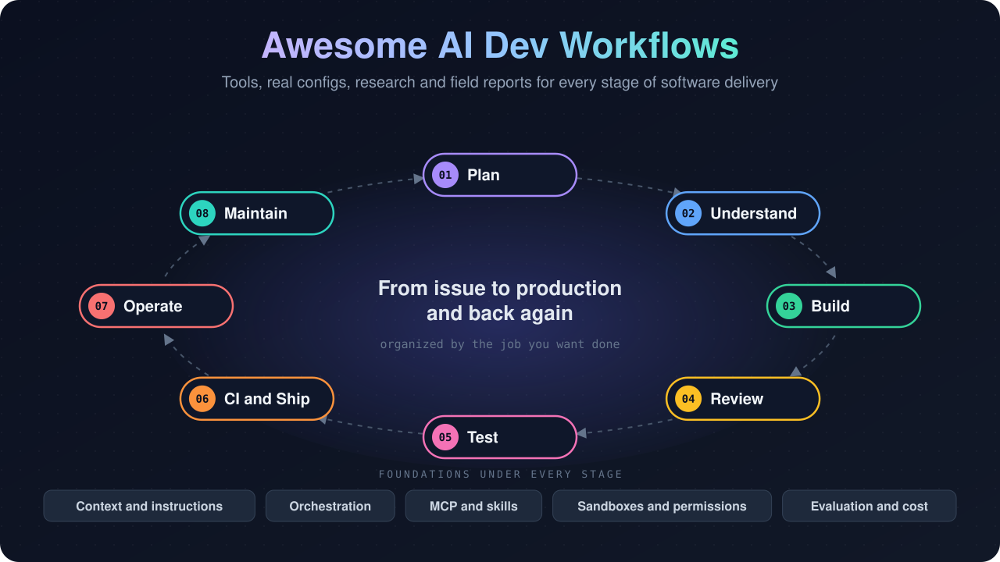

  

  
  
  

  <b>A map of how AI agents are actually used across software delivery.</b> 
  Planning, coding, review, testing, CI, operations and maintenance, with the tools, 
  the real configuration files projects run, the research, and the field reports in one place.

  <a href="#browse-by-stage">Browse by stage</a> ·
  <a href="#real-world-setups">Real-world setups</a> ·
  <a href="#evaluation-cost-and-evidence">Evidence</a> ·
  <a href="CONTRIBUTING.md">Contribute</a>

---

## Why this list

Most lists collect one kind of thing: tools, or prompts, or workflow templates. When you sit down to automate a specific job, you need all of them side by side.

* **Organized by the job.** Each section is a stage of the lifecycle, not a product category.
* **Real configs from real repositories.** See the `AGENTS.md` files, review bots and triage workflows that well known projects run today, not only vendor demos.
* **Evidence next to tools.** Controlled studies, engineering case studies and security research sit beside the tools they evaluate.
* **Agent agnostic.** Claude Code, Codex, Gemini CLI, Copilot, OpenHands, Aider and others appear where they fit.

## Legend

| Icon | Type | Icon | Type |
| :-: | --- | :-: | --- |
| 🛠️ | Tool | 🧪 | Research |
| 📘 | Documentation | 🏢 | Case study |
| 📝 | Article | 🧩 | Example workflow |
| ⚙️ | Real config | 📦 | Collection |

`$` marks resources tied to a paid plan or a single commercial service. Tools that work with a model API of your choice are not marked.

## Browse by stage

| Lifecycle | | Foundations |
| --- | --- | --- |
| 🟣 [Plan and specify](#plan-and-specify) | 🩷 [Test](#test) | 🧭 [Context and instructions](#context-and-instructions) |
| 🔵 [Understand the codebase](#understand-the-codebase) | 🟠 [CI and pipelines](#ci-and-pipelines) | 🔀 [Orchestration and parallel agents](#orchestration-and-parallel-agents) |
| 🟢 [Build](#build) | 🔴 [Operate: infrastructure and incidents](#operate-infrastructure-and-incidents) | 🔌 [MCP and skills](#mcp-and-skills) |
| 🟢 [Large scale changes and migrations](#large-scale-changes-and-migrations) | 🩵 [Maintain the repository](#maintain-the-repository) | 🔒 [Sandboxes and permissions](#sandboxes-and-permissions) |
| 🟡 [Review](#review) | 🛡️ [Security and supply chain](#security-and-supply-chain) | 📊 [Evaluation, cost and evidence](#evaluation-cost-and-evidence) |
| | 📚 [Documentation](#documentation) | 👥 [Team adoption and field reports](#team-adoption-and-field-reports) |

Also: [Real-world setups](#real-world-setups) · [Related collections](#related-collections) · [Contributing](#contributing)

---

## Real-world setups

Configuration files that open source projects actually commit. Read them to see how teams scope permissions, gate model runs and describe their codebase to agents.

### Project instructions

| Project | File | What to look at |
| --- | --- | --- |
| Next.js | [`AGENTS.md`](https://github.com/vercel/next.js/blob/canary/AGENTS.md) | A long, detailed guide for agents working in a large monorepo. |
| n8n | [`AGENTS.md`](https://github.com/n8n-io/n8n/blob/master/AGENTS.md) | Monorepo conventions and commands written for coding agents. |
| Deno | [`CLAUDE.md`](https://github.com/denoland/deno/blob/main/CLAUDE.md) | Build, test and debugging guidance for a Rust runtime. |
| Ruff | [`AGENTS.md`](https://github.com/astral-sh/ruff/blob/main/AGENTS.md) | One instruction file shared by several agents; `CLAUDE.md` only imports it. |
| Apache Airflow | [`AGENTS.md`](https://github.com/apache/airflow/blob/main/AGENTS.md) | Agent rules in a large Apache project. |
| Sentry | [`AGENTS.md`](https://github.com/getsentry/sentry/blob/master/AGENTS.md) | Instructions for a large Python and TypeScript application. |
| Temporal | [`AGENTS.md`](https://github.com/temporalio/temporal/blob/main/AGENTS.md) | A short instruction file for a Go server codebase. |
| Pydantic AI | [`AGENTS.md`](https://github.com/pydantic/pydantic-ai/blob/main/AGENTS.md) | Agent rules for a Python library that ships its own agent framework. |
| VS Code | [`copilot-instructions.md`](https://github.com/microsoft/vscode/blob/main/.github/copilot-instructions.md) | Repository instructions for GitHub Copilot. |
| TypeScript | [`copilot-instructions.md`](https://github.com/microsoft/TypeScript/blob/main/.github/copilot-instructions.md) | Copilot instructions for the TypeScript compiler. |

### Agents in CI

| Project | Workflow | What to look at |
| --- | --- | --- |
| Claude Code | [`claude-dedupe-issues.yml`](https://github.com/anthropics/claude-code/blob/main/.github/workflows/claude-dedupe-issues.yml) | Issue deduplication on an egress firewalled runner, authenticated with OIDC federation instead of a stored API key. |
| Gemini CLI | [`gemini-scheduled-issue-dedup.yml`](https://github.com/google-gemini/gemini-cli/blob/main/.github/workflows/gemini-scheduled-issue-dedup.yml) | Hourly deduplication with pinned action SHAs and least privilege job permissions. |
| Gemini CLI | [`gemini-automated-issue-triage.yml`](https://github.com/google-gemini/gemini-cli/blob/main/.github/workflows/gemini-automated-issue-triage.yml) | Labels new issues automatically. |
| Flutter samples | [`gemini-pr-review.yml`](https://github.com/flutter/samples/blob/main/.github/workflows/gemini-pr-review.yml) | PR review that only runs on demand for owners, members and collaborators. |
| tldraw | [`issue-triage.yml`](https://github.com/tldraw/tldraw/blob/main/.github/workflows/issue-triage.yml) | Triage of newly opened issues with a manual dispatch path for testing. |
| Pydantic AI | [`pydantic-ai-pr-review.md`](https://github.com/pydantic/pydantic-ai/blob/main/.github/workflows/pydantic-ai-pr-review.md) | GitHub Agentic Workflow that reviews only after CI passes, with a deterministic eligibility gate before any model runs. |
| Pydantic AI | [`pydantic-ai-docs-drift.md`](https://github.com/pydantic/pydantic-ai/blob/main/.github/workflows/pydantic-ai-docs-drift.md) | Detects documentation that no longer matches the code and files an issue. |
| Pydantic AI | [`pydantic-ai-bug-hunter.md`](https://github.com/pydantic/pydantic-ai/blob/main/.github/workflows/pydantic-ai-bug-hunter.md) | Looks for a reproducible, user impacting bug and files a report. |
| Pydantic AI | [`agent-spend-report.yml`](https://github.com/pydantic/pydantic-ai/blob/main/.github/workflows/agent-spend-report.yml) | Weekly spend report for agentic workflows, built from existing run artifacts without calling a model. |
| VS Code | [`copilot-setup-steps.yml`](https://github.com/microsoft/vscode/blob/main/.github/workflows/copilot-setup-steps.yml) | Prepares the environment the Copilot cloud agent works in. |
| Ruff | [`ai-policy.yml`](https://github.com/astral-sh/ruff/blob/main/.github/workflows/ai-policy.yml) | Enforces the project's AI contribution policy by commenting on or closing labeled issues and PRs. |

---

## Plan and specify

Turn an idea or issue into a specification, a plan and tasks an agent can execute.

* 🛠️ [Spec Kit](https://github.com/github/spec-kit): GitHub's toolkit for spec driven development, moving from specification to plan to tasks with a coding agent.
* 🛠️ [BMAD Method](https://github.com/bmad-code-org/BMAD-METHOD): Agile planning and implementation workflow built from agent roles such as analyst, architect and developer.
* 📘 [Kiro specs](https://kiro.dev/docs/specs/) `$`: Requirements, design and task files that drive implementation in the Kiro IDE.
* 📝 [Understanding spec driven development](https://martinfowler.com/articles/exploring-gen-ai/sdd-3-tools.html): Birgitta Böckeler compares Kiro, Spec Kit and Tessl.
* 📝 [My LLM codegen workflow](https://harper.blog/2025/02/16/my-llm-codegen-workflow-atm/): Harper Reed's flow from brainstormed spec to plan to step by step execution.
* 🧩 [Daily Plan](https://github.com/githubnext/agentics/blob/main/docs/plan.md): Keeps a planning issue updated with current priorities from repository activity.

## Understand the codebase

Explore an unfamiliar repository, map its architecture and give an agent the right slice of code.

* 🛠️ [Repomix](https://github.com/yamadashy/repomix): Packs a repository into a single AI friendly file, with filtering and token counts.
* 🛠️ [Gitingest](https://github.com/coderamp-labs/gitingest): Turns a GitHub repository into a prompt friendly text digest.
* 🛠️ [Serena](https://github.com/oraios/serena): MCP server that gives agents symbol level retrieval and editing through language servers.
* 🛠️ [DeepWiki](https://deepwiki.com): Generated, browsable documentation for public repositories.
* 🛠️ [DeepWiki Open](https://github.com/AsyncFuncAI/deepwiki-open): Self hosted wiki generator for GitHub, GitLab and Bitbucket repositories.
* 🧩 [Weekly Repo Map](https://github.com/githubnext/agentics/blob/main/docs/weekly-repo-map.md): Posts a weekly tree map of the repository structure and file sizes as an issue.

## Context and instructions

Persistent project knowledge: instruction files, rules and fresh documentation for agents.

* 📘 [AGENTS.md](https://agents.md): An open format for agent instructions in a repository, read by many coding agents.
* 📘 [Claude Code memory](https://code.claude.com/docs/en/memory): How `CLAUDE.md` files are loaded, scoped and imported.
* 📘 [Copilot repository instructions](https://docs.github.com/en/copilot/how-tos/copilot-on-github/customize-copilot/add-custom-instructions/add-repository-instructions): Repository wide and path specific instructions for GitHub Copilot.
* 📘 [Cursor rules](https://cursor.com/docs/rules): Project rules and their scoping in Cursor.
* 📝 [Effective context engineering for AI agents](https://www.anthropic.com/research/effective-context-engineering-for-ai-agents): Anthropic on selecting and managing what goes into an agent's context window.
* 🛠️ [Context7](https://github.com/upstash/context7): MCP server that serves current, version specific library documentation to agents.
* 📦 [Awesome Copilot](https://github.com/github/awesome-copilot): Community instructions, agents, skills and configurations for Copilot.

See also: [project instruction files in the wild](#project-instructions).

## Build

Coding agents and practices for features, bug fixes and refactoring.

* 🛠️ [Claude Code](https://github.com/anthropics/claude-code) `$`: Anthropic's terminal coding agent.
* 🛠️ [Codex CLI](https://github.com/openai/codex): OpenAI's open source terminal coding agent.
* 🛠️ [Gemini CLI](https://github.com/google-gemini/gemini-cli): Google's open source terminal agent.
* 🛠️ [OpenCode](https://github.com/anomalyco/opencode): Open source coding agent that works with several model providers.
* 🛠️ [Aider](https://github.com/Aider-AI/aider): Terminal pair programming that commits each change to git.
* 🛠️ [Cline](https://github.com/cline/cline): Coding agent available as an IDE extension, CLI and SDK.
* 🛠️ [OpenHands](https://github.com/OpenHands/OpenHands): Open source platform for software development agents.
* 🛠️ [SWE-agent](https://github.com/SWE-agent/SWE-agent): Research agent that takes a GitHub issue and attempts a fix.
* 📘 [Claude Code best practices](https://code.claude.com/docs/en/best-practices): Explore, plan, code and verify loops, plus context management.
* 📝 [How I use LLMs to help me write code](https://simonwillison.net/2025/Mar/11/using-llms-for-code/): Simon Willison's practical habits and expectations.
* 📝 [Agentic coding recommendations](https://lucumr.pocoo.org/2025/6/12/agentic-coding/): Armin Ronacher on language choice, tooling and code structure that suit agents.
* 📝 [Vibe engineering](https://simonwillison.net/2025/Oct/7/vibe-engineering/): Simon Willison on the engineering discipline needed to use agents responsibly.

## Large scale changes and migrations

Codemods, framework migrations and fleet wide changes.

* 🏢 [How is Google using AI for internal code migrations?](https://arxiv.org/abs/2501.06972): Experience report on LLM assisted migrations inside Google.
* 🏢 [Accelerating large scale test migration with LLMs](https://airbnb.tech/infrastructure/accelerating-large-scale-test-migration-with-llms/): Airbnb's migration of Enzyme tests to React Testing Library.
* 🏢 [Spotify's background coding agent](https://engineering.atspotify.com/2025/11/spotifys-background-coding-agent-part-1): Spotify on running an agent for fleet wide code changes and what more than 1,500 PRs taught them.

## Review

Pull request review, finding verification and review policies.

* 🛠️ [PR Agent](https://github.com/The-PR-Agent/pr-agent): Open source PR reviewer with describe, review and improve commands.
* 🛠️ [Claude Code Action](https://github.com/anthropics/claude-code-action) `$`: Runs Claude Code in GitHub Actions for reviews and `@claude` requests.
* 🛠️ [Codex GitHub Action](https://github.com/openai/codex-action) `$`: Runs Codex in GitHub Actions workflows.
* 🛠️ [Run Gemini CLI](https://github.com/google-github-actions/run-gemini-cli): GitHub Action for review, triage and other Gemini CLI tasks.
* 📘 [Copilot code review](https://docs.github.com/en/copilot/concepts/agent-capabilities/agent-powered-workflows-and-operations/code-review) `$`: GitHub's built in AI review.
* 📘 [CodeRabbit docs](https://docs.coderabbit.ai) `$`: Configuration and behavior of a hosted review service.
* 🏢 [Resolving code review comments with ML](https://research.google/blog/resolving-code-review-comments-with-ml/): Google on suggesting edits that address reviewer comments.
* 🧩 [Grumpy Reviewer](https://github.com/githubnext/agentics/blob/main/docs/grumpy-reviewer.md): On demand, critical review workflow.
* 🧩 [PR Nitpick Reviewer](https://github.com/githubnext/agentics/blob/main/docs/pr-nitpick-reviewer.md): Review focused on conventions and style.

## Test

Unit and regression test generation, end to end and browser testing, accessibility.

* 🛠️ [Playwright test agents](https://playwright.dev/docs/test-agents): Planner, generator and healer agents for Playwright tests.
* 🛠️ [Playwright MCP](https://github.com/microsoft/playwright-mcp): Lets agents drive a browser through accessibility snapshots.
* 🛠️ [Chrome DevTools MCP](https://github.com/ChromeDevTools/chrome-devtools-mcp): Gives agents DevTools access for debugging, network inspection and performance traces.
* 🛠️ [Browser Use](https://github.com/browser-use/browser-use): Python library for browser automation agents.
* 🛠️ [Qodo Cover](https://github.com/qodo-ai/qodo-cover): Generates tests aimed at increasing coverage.
* 🧪 [Automated unit test improvement using LLMs at Meta](https://arxiv.org/abs/2402.09171): TestGen-LLM, which only keeps generated tests that build, pass and add coverage.
* 🧪 [Mutation guided LLM based test generation at Meta](https://arxiv.org/abs/2501.12862): Generating tests that catch specific simulated faults.
* 🧩 [Daily Test Improver](https://github.com/githubnext/agentics/blob/main/docs/test-improver.md): Proposes tests for poorly covered areas.
* 🧩 [Daily Accessibility Review](https://github.com/githubnext/agentics/blob/main/docs/accessibility-review.md): Scheduled WCAG 2.2 review that documents problems found.

## CI and pipelines

Investigating failed builds, repairing PRs and improving pipeline speed and cost.

* 📘 [GitHub Agentic Workflows](https://github.github.com/gh-aw/): Agents in GitHub Actions defined in Markdown, with configured tools, permissions and safe outputs.
* 📘 [Claude Code GitHub Actions](https://code.claude.com/docs/en/github-actions): Setup and workflow patterns for Claude in CI.
* 📘 [GitLab Duo Root Cause Analysis](https://docs.gitlab.com/user/gitlab_duo_chat/examples/) `$`: Explains failed CI/CD jobs from their logs.
* 🧩 [CI Doctor](https://github.com/githubnext/agentics/blob/main/docs/ci-doctor.md): Investigates failing workflow runs.
* 🧩 [CI Coach](https://github.com/githubnext/agentics/blob/main/docs/ci-coach.md): Suggests speed and cost improvements for CI.
* 🧩 [PR Fix](https://github.com/githubnext/agentics/blob/main/docs/pr-fix.md): Analyzes failing checks on a pull request and pushes a proposed fix to its branch.

## Operate: infrastructure and incidents

Infrastructure as code, Kubernetes, production debugging and incident investigation.

* 🛠️ [HolmesGPT](https://github.com/HolmesGPT/holmesgpt): CNCF sandbox SRE agent for investigating alerts and incidents.
* 🛠️ [K8sGPT](https://github.com/k8sgpt-ai/k8sgpt): Scans Kubernetes clusters and explains problems.
* 🛠️ [Terraform MCP server](https://github.com/hashicorp/terraform-mcp-server): Terraform registry and workspace access for agents.
* 📦 [AWS MCP servers](https://github.com/awslabs/mcp): MCP servers for AWS services, IaC and documentation.
* 🛠️ [Grafana MCP server](https://github.com/grafana/mcp-grafana): Dashboards, data sources and incidents from Grafana.
* 🛠️ [Sentry MCP](https://github.com/getsentry/toolkit): Sentry's MCP server for debugging issues from a coding agent.
* 📘 [Sentry Seer](https://docs.sentry.io/product/ai-in-sentry/seer/) `$`: Root cause analysis and fix suggestions for application errors.

## Maintain the repository

Issue triage, deduplication, contribution checks and backlog work.

* 🧩 [Issue Triage](https://github.com/githubnext/agentics/blob/main/docs/issue-triage.md): Triages issues when they are opened or reopened.
* 🧩 [Repo Assist](https://github.com/githubnext/agentics/blob/main/docs/repo-assist.md): Investigates issues and proposes fixes and maintenance work.
* 🧩 [Contribution Guidelines Checker](https://github.com/githubnext/agentics/blob/main/docs/contribution-guidelines-checker.md): Reviews pull requests against contribution guidelines.
* 🧩 [Dependabot PR Bundler](https://github.com/githubnext/agentics/blob/main/docs/dependabot-pr-bundler.md): Groups Dependabot alerts into tested, bundled update PRs.

See also: [triage and deduplication workflows in the wild](#agents-in-ci).

## Security and supply chain

Security review of changes, vulnerability discovery and the security of agent workflows themselves.

* 🛠️ [Claude Code Security Review](https://github.com/anthropics/claude-code-security-review) `$`: GitHub Action that reviews PR diffs for security issues.
* 🛠️ [OSS-Fuzz-Gen](https://github.com/google/oss-fuzz-gen): LLM generated fuzz targets for OSS-Fuzz projects.
* 🏢 [Leveling up fuzzing](https://security.googleblog.com/2024/11/leveling-up-fuzzing-finding-more.html): Google on AI generated fuzz targets that found new vulnerabilities, including one in OpenSSL.
* 🧪 [From Naptime to Big Sleep](https://projectzero.google/2024/10/from-naptime-to-big-sleep.html): Project Zero and DeepMind on an agent that found an exploitable SQLite bug.
* 📝 [The lethal trifecta for AI agents](https://simonwillison.net/2025/Jun/16/the-lethal-trifecta/): Why private data, untrusted content and external communication together are dangerous.
* 🧪 [GitHub MCP exploited](https://invariantlabs.ai/blog/mcp-github-vulnerability): A malicious public issue leads an agent to leak private repository data.
* 📘 [OWASP Top 10 for LLM applications](https://genai.owasp.org/llm-top-10/): Reference risks such as prompt injection and excessive agency.
* 🧩 [Daily Malicious Code Scan](https://github.com/githubnext/agentics/blob/main/docs/malicious-code-scan.md): Checks files changed in the last 72 hours for signs such as secret exfiltration.

## Documentation

Keeping docs in sync with code and testing them.

* 🧪 [DocAgent](https://arxiv.org/abs/2504.08725): Multi agent system for generating code documentation, from Meta.
* 🧩 [Update Docs](https://github.com/githubnext/agentics/blob/main/docs/update-docs.md): Opens documentation update PRs after each push to main.
* 🧩 [Multi Device Docs Tester](https://github.com/githubnext/agentics/blob/main/docs/multi-device-docs-tester.md): Builds a docs site and tests it on mobile, tablet and desktop viewports.

See also: [docs drift detection in Pydantic AI](#agents-in-ci).

## Orchestration and parallel agents

Running several agents at once, worktrees, subagents and task handoffs.

* 🛠️ [Container Use](https://github.com/dagger/container-use): Isolated container and git branch per agent, so several can work in parallel.
* 🛠️ [Claude Squad](https://github.com/smtg-ai/claude-squad): Manages multiple terminal agents in separate worktrees.
* 🛠️ [Vibe Kanban](https://github.com/BloopAI/vibe-kanban): Kanban board that dispatches tasks to coding agents.
* 📘 [Claude Code subagents](https://code.claude.com/docs/en/sub-agents): Specialized agents with their own context and tool permissions.
* 📘 [Parallel sessions with git worktrees](https://code.claude.com/docs/en/common-workflows): Common workflows including worktree based parallel work.
* 📝 [Building effective agents](https://www.anthropic.com/research/building-effective-agents): Anthropic on workflow patterns versus autonomous agents.

## MCP and skills

Connecting agents to tools, services and reusable capabilities.

* 📘 [Model Context Protocol](https://modelcontextprotocol.io): The protocol specification and guides.
* 🛠️ [GitHub MCP server](https://github.com/github/github-mcp-server): GitHub's official MCP server for issues, PRs, Actions and code.
* 📦 [MCP reference servers](https://github.com/modelcontextprotocol/servers): Reference implementations and a directory of servers.
* 📦 [Agent Skills](https://github.com/anthropics/skills): Example skills, packaged instructions and scripts an agent loads on demand.
* 📘 [Claude Code hooks](https://code.claude.com/docs/en/hooks-guide): Deterministic commands that run at agent lifecycle events.

## Sandboxes and permissions

Sandboxing, credentials, approvals and network control for agents.

* 📝 [Making Claude Code safer with sandboxing](https://www.anthropic.com/research/claude-code-sandboxing): Filesystem and network isolation to reduce permission prompts.
* 🛠️ [Sandbox Runtime](https://github.com/anthropics/sandbox-runtime): Filesystem and network restrictions for arbitrary processes without a container.
* 📘 [Claude Code sandboxing](https://code.claude.com/docs/en/sandboxing): Configuring the sandboxed Bash tool.
* 🛠️ [E2B](https://github.com/e2b-dev/E2B): Open source cloud sandboxes for running agent generated code.
* 📘 [Copilot agent environment](https://docs.github.com/en/copilot/how-tos/copilot-on-github/customize-copilot/customize-cloud-agent/customize-the-agent-environment): Setup steps, runners and firewall for the Copilot cloud agent.

## Evaluation, cost and evidence

Benchmarks, controlled studies, evaluation tooling and spend tracking.

* 🧪 [Measuring the impact of early 2025 AI on experienced open source developers](https://metr.org/blog/2025-07-10-early-2025-ai-experienced-os-dev-study/): METR's randomized controlled trial, in which developers were slower with AI tools than without despite expecting a speedup.
* 🧪 [DORA State of AI assisted Software Development 2025](https://dora.dev/research/2025/dora-report/): Survey based research on how AI adoption relates to delivery performance.
* 🧪 [SWE-bench](https://www.swebench.com): Benchmark of real GitHub issues and its leaderboards.
* 🧪 [Terminal-Bench](https://www.tbench.ai): Benchmark of agent tasks in a terminal.
* 🛠️ [promptfoo](https://github.com/promptfoo/promptfoo): Tests and red teams prompts and agents in CI.
* 🛠️ [ccusage](https://github.com/ccusage/ccusage): Reports local token usage and cost for coding agent sessions.

See also: [agent spend reporting in Pydantic AI](#agents-in-ci).

## Team adoption and field reports

How engineering organizations introduce agents and what they learned.

* 🏢 [How Anthropic teams use Claude Code](https://claude.com/resources/articles/how-anthropic-teams-use-claude-code): Usage across engineering, security, data and non engineering teams.
* 📝 [Exploring generative AI](https://martinfowler.com/articles/exploring-gen-ai.html): Thoughtworks memo series on AI assisted delivery.

More case studies live in their stage: [migrations](#large-scale-changes-and-migrations), [review](#review), [testing](#test), [security](#security-and-supply-chain).

## Related collections

* 📦 [The Agentics](https://github.com/githubnext/agentics): Reusable GitHub Agentic Workflows for review, testing, CI and maintenance.
* 📦 [Awesome AI Code Review](https://github.com/kodustech/awesome-ai-code-review): Review agents, tools and research papers.
* 📦 [Awesome Agentic DevOps](https://github.com/DevOpsAIguru123/awesome-agentic-devops): DevOps, cloud and SRE agents, MCP servers and skills.
* 📦 [Awesome Agentic Engineering](https://github.com/fatihkc/awesome-agentic-engineering): Writing, courses and case studies about building software with coding agents.
* 📦 [Awesome AI Workflows](https://github.com/Neeeophytee/awesome-ai-workflows): Workflow recipes for coding, review and orchestration.
* 📦 [Awesome GitHub Agentic Workflows](https://github.com/OneRose328/awesome-agentic-workflows): Templates for PR automation, releases and maintenance.

## Contributing

Know a tool, a real config or a field report that belongs here? See [CONTRIBUTING.md](CONTRIBUTING.md). Real configuration files from public repositories are especially welcome.

## License

[CC0 1.0](LICENSE). To the extent possible under law, the contributors have waived all copyright to this list.
